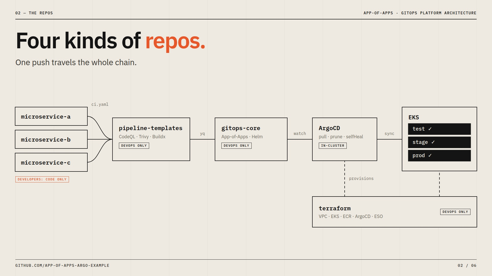
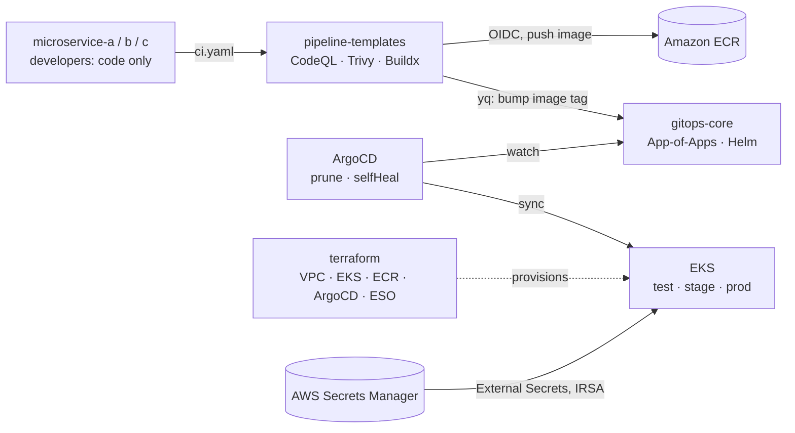

# App-of-Apps GitOps Platform on EKS

A pull-based GitOps platform: developers only `git push`. One locked pipeline scans, builds and ships the image, then bumps a tag in Git. ArgoCD syncs `test`, `stage` and `prod` from that repository. Nobody runs `kubectl apply`.

## Demo

<!-- VIDEO: on github.com, edit this file, drag profile/assets/demo.mp4 onto the next line, commit. GitHub replaces it with an inline player. -->

[](assets/demo.mp4)

*45 seconds: one push travels the whole chain; we delete a deployment and ArgoCD restores it in 9 seconds, while a push-model deploy stays gone.*

## Results

| What we tested | Result |
|---|---|
| Deleted the `microservice-a-test` deployment | ArgoCD self-heal restored it in **9 seconds** |
| Same test on a push-model deploy (`kubectl apply` from CI) | `No resources found` — no reconciliation, no drift detection |
| Deploys to test, stage and prod by the CI bot | **20 deploys, zero `kubectl apply`** |
| Commit with a command-injection bug | Blocked by CodeQL in the central pipeline |

## Repositories

| Repository | Purpose | Tools | Who can write |
|---|---|---|---|
| [terraform](https://github.com/App-of-apps-argo-example/terraform) | VPC, EKS, ECR, ArgoCD and External Secrets bootstrap | Terraform, tfsec, S3/DynamoDB state | DevOps |
| [pipeline-templates](https://github.com/App-of-apps-argo-example/pipeline-templates) | One reusable build-and-deploy workflow for every service | GitHub Actions, CodeQL, Trivy, Buildx, OIDC, yq | DevOps |
| [gitops-core](https://github.com/App-of-apps-argo-example/gitops-core) | Desired state of the cluster, App-of-Apps | ArgoCD, Helm | DevOps and CI bot |
| [microservice-a](https://github.com/App-of-apps-argo-example/microservice-a), [-b](https://github.com/App-of-apps-argo-example/microservice-b), [-c](https://github.com/App-of-apps-argo-example/microservice-c) | Application code and a 20-line `ci.yaml` | Dockerfile | Developers |

## Architecture



## How a change reaches production

1. A developer pushes to `test`, `stage` or `main` in a microservice repository.
2. The service's `ci.yaml` calls the central workflow in `pipeline-templates`.
3. CodeQL scans the source code. The build stops on a finding.
4. Buildx builds a multi-arch image (`linux/amd64`, `linux/arm64`). Trivy scans it and fails on `CRITICAL` or `HIGH`.
5. GitHub Actions gets a short-lived AWS role through OIDC and pushes the image to ECR. No AWS keys are stored in GitHub.
6. The CI bot bumps the image tag in `gitops-core` with `yq` (`values-test.yaml`, `values-stage.yaml` or `values-prod.yaml`).
7. ArgoCD sees the commit and syncs the namespace. `prune` and `selfHeal` keep the cluster equal to Git.
8. External Secrets Operator reads the database password from AWS Secrets Manager through IRSA and gives it to the new pods.

## Design decisions

- **Pull, not push.** CI never touches the cluster. ArgoCD reconciles continuously, so manual changes and deletions revert to Git.
- **Separation of duties.** Developers write code only. They cannot edit the pipeline, skip the scans or change cluster state.
- **No static cloud keys.** GitHub Actions uses OIDC to assume `GitHubActionsDeployRole`.
- **No secrets in Git.** External Secrets Operator syncs them from AWS Secrets Manager at runtime.
- **One chart, three environments.** A single `general-service` Helm chart with per-environment values files.

## Bootstrap from zero

<details>
<summary>1. Trust GitHub in AWS (OIDC)</summary>

```bash
export GITHUB_ORG="App-of-apps-argo-example"
export AWS_ACCOUNT_ID=$(aws sts get-caller-identity --query Account --output text)

aws iam create-open-id-connect-provider \
  --url "https://token.actions.githubusercontent.com" \
  --client-id-list "sts.amazonaws.com" \
  --thumbprint-list "1b511abead59c6ce207077c0bf0e0043b1382612"

cat <<POLICY > trust-policy.json
{
  "Version": "2012-10-17",
  "Statement": [{
    "Effect": "Allow",
    "Principal": { "Federated": "arn:aws:iam::${AWS_ACCOUNT_ID}:oidc-provider/token.actions.githubusercontent.com" },
    "Action": "sts:AssumeRoleWithWebIdentity",
    "Condition": {
      "StringLike":   { "token.actions.githubusercontent.com:sub": "repo:${GITHUB_ORG}/*" },
      "StringEquals": { "token.actions.githubusercontent.com:aud": "sts.amazonaws.com" }
    }
  }]
}
POLICY

aws iam create-role --role-name GitHubActionsDeployRole \
  --assume-role-policy-document file://trust-policy.json
# Demo only: scope this down for real use.
aws iam attach-role-policy --role-name GitHubActionsDeployRole \
  --policy-arn arn:aws:iam::aws:policy/AdministratorAccess
```
</details>

<details>
<summary>2. Give the CI bot access to gitops-core</summary>

Add an organization secret `GITOPS_BOT_TOKEN` with write access to `gitops-core`. The central pipeline uses it to commit the new image tag.
</details>

<details>
<summary>3. Provision the infrastructure</summary>

In `terraform`, run the **Deploy EKS and ArgoCD** workflow. It creates the S3/DynamoDB state backend if missing, the VPC and an EKS 1.35 cluster, one ECR repository per service (keeps the last 20 images), and installs ArgoCD pointed at `gitops-core`.
</details>

<details>
<summary>4. Deploy</summary>

Push to `microservice-a`, `-b` or `-c`. The pipeline builds, scans, pushes and bumps the tag; ArgoCD rolls it out.
</details>

---

Built by [Vitalii Yankovskyi](https://linkedin.com/in/vitalii-yankovskyi-lviv) as a bachelor's thesis project at Lviv Polytechnic National University, 2026.
